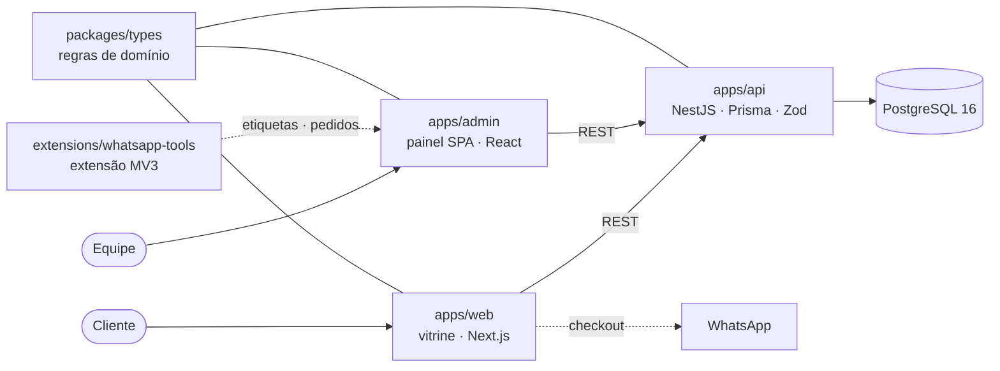

# Armarinho Aurora — E-commerce de catálogo

[](https://github.com/lukecarva/ecommerce-armarinho-aurora/actions/workflows/ci.yml)
[](LICENSE)


Loja virtual de catálogo com checkout via WhatsApp. O cliente navega e monta o
carrinho no site; ao finalizar, o pedido é registrado no banco e ele é levado ao
WhatsApp com a mensagem pronta, onde a equipe fecha a venda.

**O site não processa pagamentos e não calcula frete.** A entrega tem duas
opções: retirar na loja ou motoboy com valor combinado no atendimento.

> 🧪 **Projeto de portfólio.** A loja "Armarinho Aurora" e todos os dados
> (endereço, telefone, CNPJ, e-mails) são **fictícios**.

## Stack

| Camada   | Tecnologia                                                     |
| -------- | -------------------------------------------------------------- |
| Vitrine  | Next.js 15 (App Router) · React 19 · Tailwind CSS 4            |
| Painel   | Vite · React 19 · TanStack Query                               |
| API      | NestJS 11 · Prisma 6 · Zod                                     |
| Banco    | PostgreSQL 16 (`unaccent` + `pg_trgm` para busca em português) |
| Extensão | Chrome Manifest V3                                             |
| Monorepo | pnpm workspaces · Turborepo                                    |

## Arquitetura



### Estrutura

```
apps/
  web      → vitrine pública (SSR/ISR, SEO, PWA)     :3000
  admin    → painel administrativo (SPA)             :5173
  api      → API REST + OpenAPI                      :3333
packages/
  types    → regras de domínio compartilhadas (preço, quantidade, WhatsApp, horário)
  ui       → design system (tokens + componentes)
  config   → tsconfig e ESLint compartilhados
extensions/
  whatsapp-tools → extensão MV3 para o WhatsApp Web
infra/     → exemplos de deploy (nginx, systemd, deploy.sh)
```

O pacote `types` é o coração do domínio: unidade de venda, dinheiro em
centavos, montagem da mensagem do WhatsApp e horário de funcionamento vivem lá,
com testes, e são usados igualmente pela vitrine, pelo painel e pela API.

## Pré-requisitos

- **Node.js 20.11+** (testado em 24)
- **pnpm 12** — `npm i -g pnpm`
- **Docker Desktop** — para Postgres, MinIO e Mailpit locais

## Primeiros passos

```bash
pnpm install
cp .env.example .env
pnpm infra:up          # sobe Postgres, MinIO e Mailpit
pnpm db:migrate        # cria o schema
pnpm db:seed           # popula loja, categorias e produtos de exemplo (fictícios)
pnpm dev               # sobe web + admin + api
```

| Serviço                    | URL                                 |
| -------------------------- | ----------------------------------- |
| Vitrine                    | http://localhost:3000               |
| Design system              | http://localhost:3000/design-system |
| Painel                     | http://localhost:5173               |
| API                        | http://localhost:3333/api           |
| Documentação da API        | http://localhost:3333/api/docs      |
| Mailpit (e-mails de teste) | http://localhost:8025               |
| MinIO (arquivos)           | http://localhost:9001               |

> A vitrine funciona mesmo com a API fora do ar — ela cai em dados padrão em vez
> de mostrar erro. Dá para rodar `pnpm dev` sem Docker só para mexer no visual.

## Comandos

| Comando                        | O que faz                            |
| ------------------------------ | ------------------------------------ |
| `pnpm dev`                     | Sobe os três apps em paralelo        |
| `pnpm build`                   | Build de tudo                        |
| `pnpm lint`                    | ESLint no monorepo                   |
| `pnpm typecheck`               | TypeScript sem emitir                |
| `pnpm test`                    | Testes (Vitest)                      |
| `pnpm format`                  | Prettier                             |
| `pnpm infra:up` / `infra:down` | Sobe/derruba os containers locais    |
| `pnpm db:migrate`              | Aplica migrations                    |
| `pnpm db:seed`                 | Semeia dados fictícios (idempotente) |
| `pnpm db:studio`               | Prisma Studio                        |
| `pnpm db:reset`                | Recria o banco do zero               |

## Convenções

- **Commits:** Conventional Commits com escopo, ex.: `feat(catalogo): importar planilha`.
  Os escopos válidos estão em `commitlint.config.cjs`.
- **Dinheiro:** sempre centavos inteiros no código. O banco guarda `Decimal(10,2)`
  e a conversão acontece na borda da API.
- **Quantidade:** `Decimal(10,3)` — tecido é vendido em frações de metro.
- **Estoque:** a vitrine mostra _disponibilidade_, nunca a quantidade exata.
- **Marca:** logo, favicon e cores são enviados pelo painel. Nenhum arquivo de
  marca é versionado aqui.

## Painel administrativo

Depois de `pnpm db:seed`, o terminal mostra o e-mail e a senha do primeiro
usuário (a senha é sorteada quando `ADMIN_PASSWORD` não está definida no
`.env`). Entre em http://localhost:5173.

| Módulo                | O que faz                                                                             |
| --------------------- | ------------------------------------------------------------------------------------- |
| Produtos              | Cadastro completo (unidade de venda, passo, preço, promoção, variações, estoque, SEO) |
| Categorias            | Árvore com reordenação, subcategorias e proteção contra ciclo                         |
| Coleções              | Campanhas com janela de datas — entram e saem da vitrine sozinhas                     |
| Cupons                | Descontos por valor ou percentual, com regras de uso                                  |
| Clientes              | Cadastro, grupos de preço e histórico de pedidos                                      |
| Pedidos               | Kanban por status, detalhe com timeline, valor fechado                                |
| Mídia                 | Upload com geração automática de WebP/AVIF em 4 larguras e blurhash                   |
| Importação/Exportação | Catálogo via planilha, com imagens                                                    |
| Identidade visual     | Logo, favicon e cores da marca; os ícones do PWA saem do logo                         |
| Cursos                | Turmas presenciais, vagas, inscrições e pagamentos (controle interno)                 |
| Agenda / Tarefas      | Agenda das turmas e lista de tarefas da equipe                                        |
| Relatórios            | Vendas por período, funil do WhatsApp, curva ABC                                      |
| Configurações         | Dados cadastrais, horário de funcionamento e formas de receber                        |
| Usuários              | Contas, perfis de acesso e matriz de permissões (RBAC)                                |
| Auditoria             | Quem alterou o quê, quando, com o antes e o depois                                    |

## A extensão

Extensão Chrome Manifest V3 em `extensions/whatsapp-tools` (JavaScript, sem etapa
de build): marca conversas do WhatsApp com os pedidos do contato e abre um pedido
novo no painel já preenchido. Para carregar: `chrome://extensions` → **Modo do
desenvolvedor** → **Carregar sem compactação** → pasta `extensions/whatsapp-tools`.

## Licença

[MIT](LICENSE).
